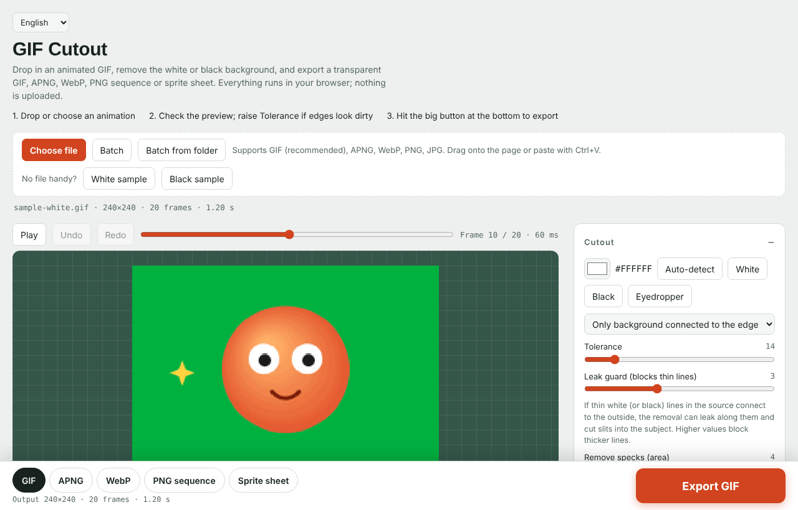

[English](README.md) · [简体中文](README.zh-CN.md) · [日本語](README.ja.md) · [Русский](README.ru.md) · [Español](README.es.md) · [한국어](README.ko.md)

# GIF背景カッター（GIF Cutout）

アニメGIFの白・黒などの単色背景をブラウザだけで切り抜きます。ファイル1つ、インストール不要、アップロードなし。

## 使い方

- **オンライン：** **https://weavervictorwings.github.io/gif-cutout/** を開く
- **オフライン：** [`index.html`](index.html) をダウンロードしてダブルクリック。これだけです。

## 3ステップで始める

1. GIFをドロップ（または**ファイルを選択**。**白背景サンプル**ですぐ試せます）。
2. プレビューを確認し、縁が汚ければ**許容値**を上げる。
3. 下部の大きな**書き出し**ボタンを押す。

## 機能

- 背景色を自動検出。スポイトで任意の単色も指定可能
- **リーク防止**と**自動すき間埋め**で、元画像の細い線による筋抜けを防止
- ブラシと**自動選択（魔棒）**で手動修正、元に戻す／やり直し対応。エッジのぼかし、フチ除去
- 輪郭線・影・グロー・色調補正、逆再生・往復再生・コマ間引き・背景の差し替え
- 入力：GIF・APNG・WebP・PNG・JPG、貼り付け、フォルダ一括処理
- 出力：GIF（目標サイズ指定可）・APNG・アニメWebP・PNG連番（zip）・スプライトシート
- 6言語対応。自動判定で、左上から切り替え可能

## 制限

- GIFの透明は「あり／なし」のみで、縁が少しギザギザになります。滑らかな縁にはAPNGかWebPを。
- APNG／WebPアニメの読み込みには `ImageDecoder` 対応ブラウザ（新しいChrome・Edge・Safari）が必要。非対応では最初のフレームのみ。
- グラデーション・影・テクスチャのある背景は単色方式では完全には消せません。手動ツールを併用してください。

## ライセンス

[MIT](LICENSE)
