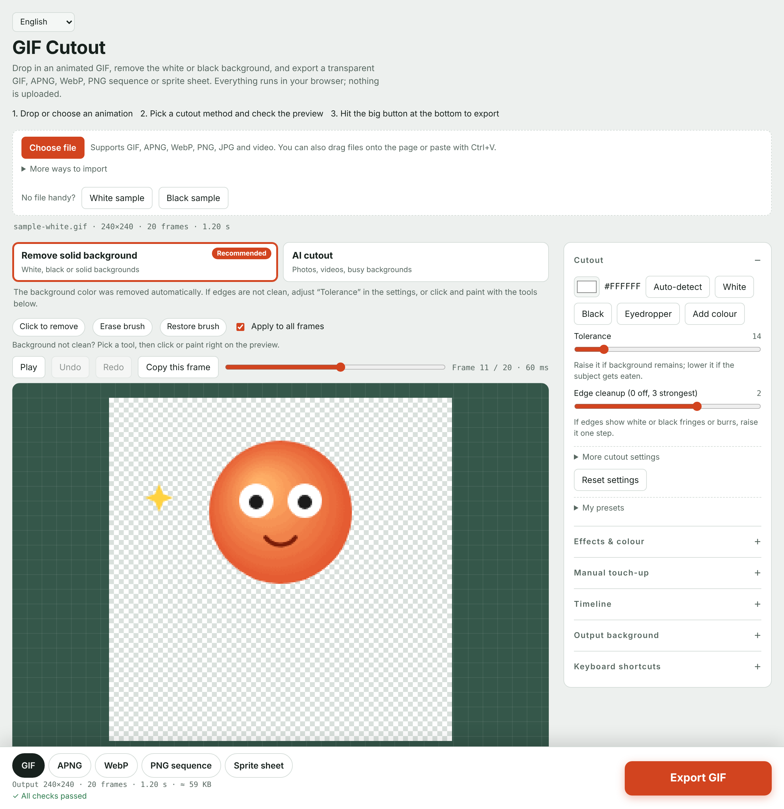

[English](README.md) · [简体中文](README.zh-CN.md) · [繁體中文](README.zh-TW.md) · [日本語](README.ja.md) · [한국어](README.ko.md) · [Русский](README.ru.md) · [Español](README.es.md) · [Português](README.pt.md) · [Français](README.fr.md) · [Deutsch](README.de.md)

# GIF 抠底台

在浏览器里把动图的白底、黑底或任意纯色背景抠掉。单个文件，不用安装，文件不会上传。

## 怎么用

- **在线使用：** 打开 **https://weavervictorwings.github.io/gif-cutout/**
- **离线使用：** 下载 [`index.html`](index.html)，双击用浏览器打开就行，这就是全部「安装」步骤。

## 三步上手

1. 拖入一个 GIF（或点**选择文件**；点**白底示例**可以立刻试玩）。
2. 看预览，边缘不干净就调高**容差**。
3. 点底部那个大大的**导出**按钮。

## 功能

- 自动识别背景色（连假「透明」棋盘格也能识别），吸管可追加最多 6 种背景色
- **穿透保护**和**自动补缝**：原图里的细线不会再在主体上抠出缝
- 智能**魔棒**（顺着渐变和纹理扩展、遇到轮廓停下，拖动调容差，Shift 加选 / Alt 减选，会跟着主体在各帧间移动）、套索、框选、**智能画笔**、补色画笔；所有操作都能撤销 / 重做
- 描边、投影、发光、调色；倒放、来回播放、抽帧、换背景
- 缩放平移、按住 **C** 看原图、起点 / 终点、复制当前帧为透明 PNG、快捷键、自动记住设置
- 输入：GIF、APNG、WebP、PNG、JPG，支持粘贴和批量处理文件夹
- 导出：GIF（可设目标大小、颜色数、边缘预混合）、APNG、动画 WebP、PNG 序列（zip）、精灵图；可同时导出多种格式，打包成一个 zip
- 表情预设（微信、Discord、Slack、LINE）、补成正方形、裁剪框、合并重复帧、实时体积估算
- 还能：**视频转动图**（mp4 / webm，可选时间段、帧率、尺寸）、**多张图合成动图**、加**字幕**；手动修改**自动保存在你的浏览器里**，再次打开同一个文件时可恢复；导出前有检查清单，新增 WhatsApp 预设；可选的**AI 抠图**（实验功能，模型在浏览器里运行，第一次使用时下载）
- 预览上方直接给出三种抠图方式：**去纯色底**、**AI 抠图**和**魔棒**（点一下背景就去掉），并按每个文件自动推荐。帧数多、尺寸大的动图会自动缩小，避免浏览器内存不够；导出时保留播放次数（无限循环或播放 N 次）；页面不再加载任何外部字体，在访问不了 Google 的网络下也能立刻打开。 AI 抠图后还有「主体填实」「只留最大主体」两个开关，专治主体发虚、透底。
- 边缘更干净：抠完后主体周围的**零星碎片**会自动擦掉（手动恢复过的地方不会动），**帧间平滑**减少静止部分的闪烁。另外：**拆精灵图**成动图、**循环检查**并可一键裁到最顺的位置、**色相**调色、**我的预设**（存在浏览器里）。
- 10 种语言，自动识别，左上角可切换

## 已知限制

- GIF 的透明只有「有 / 没有」，边缘会有些锯齿；要平滑边缘请导出 APNG 或 WebP。
- 读取 APNG / WebP 动画需要浏览器支持 `ImageDecoder`（较新的 Chrome、Edge、Safari），其他浏览器只载入第一帧。
- 渐变、阴影或有纹理的背景无法用纯色方式完美去除，可配合手动工具。
- AI 抠图是实验功能：需要能访问 cdn.jsdelivr.net / unpkg.com；模型只在你选用时才下载（5–179 MB，存在浏览器里）。它会先试跑当前这一帧，让你确认后再处理全部帧，并且只处理要导出的帧。没有哪个模型适合所有素材（在我们的 18 个测试素材上，「通用高质量」最稳）。浏览器里的速度和 WebGPU 加速取决于你的设备。

## 许可证

[MIT](LICENSE)
